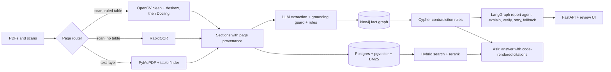

# DocuGraph AI


Document-compliance pipeline that turns messy PDFs into a knowledge graph, finds conflicts between contracts, policies, regulations, certificates and invoices, and reports each one with page-level evidence and a human review step. Built with open-source tools only and developed on a CPU-only laptop with 8 GB RAM.

> All documents are **synthetic**. No real contracts were used. Numbers below come from small test sets written by one author; read the limitations before drawing conclusions.


## What it does
- Ingests digital and scanned PDFs, routing each page to the cheapest parser that works (PyMuPDF, RapidOCR, or OpenCV cleanup then Docling for scanned tables).
- Extracts structured facts (response times, breach-notice hours, insurance amounts, dates) with a small local LLM, guarded by a literal-value check, and stores them in Neo4j with document, section and page provenance.
- Detects conflicts with deterministic Cypher rules, so the result does not depend on an LLM comparing two passages.
- Writes an explanation per finding with a LangGraph agent that rejects any explanation containing numbers not found in the cited clauses. Citations are rendered by code, never by the model.
- Review UI: accept, reject or edit each finding; a conflict graph; and a question box (small local model, labelled as such).

## Architecture


## Results
Metric definitions: recall is the share of expected clauses or facts found. "Dev" sets were used to choose the design; "held-out" sets were written afterwards and scored once.

**Retrieval (Recall@3, hybrid = RRF fusion of vector and BM25 followed by a cross-encoder rerank)**

| Query type | Dev n=9: vector / BM25 / hybrid+rerank | Held-out n=12: vector / BM25 / hybrid+rerank |
|---|---|---|
| paraphrase | 0.89 / 0.28 / 0.78 | 1.00 / 0.92 / 1.00 |
| exact token | 0.25 / 1.00 / 1.00 | 0.50 / 1.00 / 1.00 |
| table | 1.00 / 1.00 / 1.00 | 1.00 / 1.00 / 1.00 |
| multi-hop | 0.00 / 0.50 / 0.50 | 1.00 / 1.00 / 0.75 |

Latency per query: vector 37 ms, BM25 under 1 ms, hybrid + rerank about 300 ms (CPU).
Vector search failed on exact tokens in both sets. On the held-out set BM25 alone matched the full pipeline overall, so the reranker's benefit is not shown by these data.

**Extraction (held-out: 12 clauses, 10 facts)**: recall 0.90, precision 1.00, no false facts on 4 negative clauses; rule-based bound detection correct on 7 of 9. A literal-value guard raised dev precision from 0.73 to 0.92 by dropping invented values.

**Conflict detection (planted issues in the answer key)**

| Corpus | Detected | Citation pages correct | False alarms on controls |
|---|---|---|---|
| A (system was built on it) | 7/7 (key extended once after the pipeline found a true violation it omitted) | 16/16 | decoy could not fail (nothing extracted) |
| B (second corpus, pipeline unchanged, run once) | 4/6 | 10/10 | 0/3 TODO: confirm the controls had max/min bounds |

Corpus B misses: a "Priority 1" vs "Critical" severity-word mismatch (severity is matched by literal word, so the pair was never compared), and an insurance shortfall TODO: state the confirmed cause from the bound check, or write "cause not confirmed".

**Report agent**: 9/9 explanations passed the number check on the first attempt. Manual review of those 9: TODO accepted / edited / rejected counts from `scripts/review_stats.py` (one reviewer, who is also the author). The number check does not detect wrong reasoning.

**Ask a question (n=10)**: 4/6 answerable questions answered, 2/4 unanswerable refused; expected clauses were cited in every answered case, but answer correctness was not scored. The two wrong answers came from a rule-based fallback, and in smoke tests the 3B model sometimes refused answerable questions or conflated unrelated clauses. The UI labels these answers accordingly.

## Run it locally
Requirements: Docker, Python 3.12, [uv](https://docs.astral.sh/uv/), [Ollama](https://ollama.com).

```powershell
git clone https://github.com/Stella747/docugraph-ai
cd docugraph-ai
uv venv --python 3.12
.venv\Scripts\activate
uv pip install -e ".[dev]"
copy .env.example .env          # set passwords
docker compose up -d
ollama pull qwen2.5:3b
python scripts\generate_corpus.py
python scripts\ingest.py
python scripts\build_index.py
python scripts\extract_facts.py
python scripts\load_graph.py
python scripts\find_contradictions.py
python scripts\eval_findings.py
python scripts\run_report.py
python -m uvicorn docugraph.api.main:app --port 8000
```

Demo image (precomputed results; the ask box is disabled there because it needs Ollama and Postgres):

```powershell
docker build -t docugraph-demo .
docker run --rm -p 8001:8000 docugraph-demo
```

## Repository layout
`src/docugraph/` ingest, retrieval, extract, agents, api · `scripts/` pipeline steps and evaluations · `evaluation/` answer keys and query sets · `docs/EVALUATION.md` full results and limitations · `corpus_b/` second-corpus generator and results · `demo_data/` precomputed demo results · `tests/`.

## Design decisions
- **Rules where correctness matters, LLM where language matters.** Conflicts come from Cypher over extracted facts; the model writes explanations and answers.
- **Provenance from the first step.** Every section carries document, page and section number, so citations are copied by code.
- **Evaluation before features.** Each component was measured against an answer key, and negative results are kept in `docs/EVALUATION.md`.

### Report Explanation Quality (Human Review)
While 9/9 report explanations were automatically verified for numerical grounding, automated verification checks numeric facts rather than narrative direction or domain correctness.

To establish an accurate quality baseline, all 9 finding explanations were evaluated via manual human review using the built-in review workflow:
- **Human Review Verdict:** **6 of 9 explanations accepted upon manual review** (6 accepted, 3 rejected).
- **Verification vs. Quality Gap:** Numerical grounding verification achieved 100% (9/9), while human-assessed explanation quality reached 66.7% (6/9).

## Limitations
- Synthetic documents, one author, small test sets (n between 9 and 12; one clause is about 8% of a score).
- Extraction uses a closed list of eight attributes; direction (max/min) comes from a fixed cue-word list that failed on unfamiliar phrasings; severity words must match literally.
- The pipeline skips a pair silently when direction or severity cannot be determined. A needs-review finding would be safer.
- A 3B local model is unreliable at cross-clause reasoning; checks on format and numbers do not catch that.
- Reviewer decisions are stored but not used to improve anything yet.
- Generated filler clauses share one section number (generator bug, not fixed); the planted issues are unaffected.
- No clean control run isolates the effect of image preprocessing on Docling's table detection.

## Roadmap
Needs-review findings for undecidable pairs; severity aliases per document; a larger model for answers; a third corpus; tracing with Langfuse.

