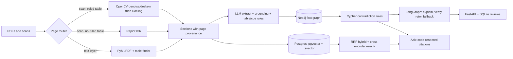

# DocuGraph AI


**Open-source document-compliance pipeline** that turns synthetic contracts, policies, regulations, certificates, and invoices into a fact graph, then finds conflicts with **deterministic Cypher rules**—not an LLM comparing two passages. Each finding is explained with a LangGraph agent, cited at **document / section / page**, and reviewed in a FastAPI UI.

Built on a CPU-only laptop with 8 GB RAM. No proprietary APIs.

> All documents are **synthetic**. Metrics come from small, author-written test sets. Read [Limitations](#limitations) and [`docs/EVALUATION.md`](docs/EVALUATION.md) before drawing conclusions.

## Problem solved

Vendor packs mix scanned PDFs, tables, and overlapping obligations (SLA hours, breach notice, insurance, payment terms). Vector search alone misses exact tokens; an LLM asked to “find contradictions” invents numbers and cannot be audited.

DocuGraph splits the job:

| Layer | Who decides | Why |
|---|---|---|
| Parse | Router (PyMuPDF / RapidOCR / OpenCV + Docling) | Cheapest parser that can read the page |
| Retrieve | Hybrid search (vector + BM25 + rerank) | Exact tokens and paraphrases |
| Extract | Small local LLM + literal-value guard + cue-word bounds | Language in, numbers only if they appear in the clause |
| Conflict | Cypher over Neo4j facts | Repeatable, independent of the model |
| Explain / Ask | LangGraph + Ollama, citations attached in code | Prose where it helps; numbers and citations stay grounded |

## Architecture



**Page routing (actual code path):** a page with a text layer always goes through PyMuPDF (`find_tables` + blocks). A scanned page is binarized and deskewed; if OpenCV finds enough ruling lines (`≥3` horizontal, `≥2` vertical), Docling exports Markdown tables; otherwise RapidOCR runs on the original page raster (200 DPI), not the cleaned image.

**Ask expansion is not a live graph walk.** `/api/ask` retrieves `k=3` hybrid hits, then adds the other side of any conflict already stored in `data/processed/findings.json`.

## Tech stack (what the code imports)

| Role | Library / service |
|---|---|
| API & UI | FastAPI, Uvicorn, Pydantic, Cytoscape.js (CDN), SQLite (`reviews.db`) |
| Ingest | PyMuPDF, RapidOCR + ONNX Runtime, OpenCV, Docling, ReportLab (synthetic PDF generation) |
| Retrieval | PostgreSQL 16 + pgvector, `psycopg`, in-memory `rank-bm25`, `sentence-transformers` (`BAAI/bge-small-en-v1.5`, 384-d), cross-encoder `cross-encoder/ms-marco-MiniLM-L-6-v2` |
| Graph | Neo4j 5 Community (`bolt://localhost:7687`) |
| LLM | Ollama `qwen2.5:3b`, LangGraph (report agent only) |
| Packaging | Python `>=3.11` (`pyproject.toml`); CI and Docker use **3.12**. `uv` recommended |

Postgres full-text (`tsvector` / `to_tsquery`) is implemented as search mode `keyword`, but the production ask path uses **`hybrid_rerank`**: RRF of vector + BM25, then the MiniLM reranker (`pool=20`, `k=3`).

Langfuse is on the roadmap only. It is not in the codebase.

## Key technical challenges and tradeoffs

- **Rules where correctness matters, LLM where language matters.** Four Cypher rules (`requirement_vs_commitment`, `internal_inconsistency`, `coverage_gap`, `invoice_vs_contract`) compare extracted facts. The model never votes on whether two clauses conflict.
- **Grounding over fluency.** Extraction keeps a value only if that numeral or date appears in the clause. Bound (`min` / `max` / `exact`) comes from a cue-word list, not the model. Report and ask loops reject invented digits; citations are copied from stored sections by code.
- **Closed schema of eight attributes.** Incident response/resolution hours, breach-notice hours, payment terms, cyber insurance USD, contract start/end, insurance end. Tables are parsed with a Markdown rule, not the LLM. Severity for comparison is the **literal word** in the clause (`critical` / `high` / …); report **risk** is a hand-written map in `report_graph.py`.
- **Silent skips vs false alarms.** If bound is `exact` or severity strings differ (`Priority 1` vs `Critical`), Cypher never compares the pair. Corpus B missed 2 of 6 planted issues for exactly those reasons. A `needs-review` finding would be safer; it is not implemented.
- **Hybrid retrieval cost.** Vector failed exact-token queries; BM25 was cheap and strong on held-out data. Hybrid + rerank (~300 ms/query on CPU) avoided a collapsed query type but did not beat BM25 overall on the held-out set.
- **3B local model ceiling.** Automated number/format checks passed 9/9 report explanations on the first try; they do **not** catch inverted reasoning. Ask sometimes refuses answerable questions or conflates clauses and still passes checks.

## Results (small synthetic sets)

Metric: recall is the share of expected clauses or facts found. Dev sets informed design; held-out sets were scored once.

**Retrieval (Recall@3)** — hybrid = RRF(vector, BM25) + cross-encoder rerank

| Query type | Dev n=9: vector / BM25 / hybrid+rerank | Held-out n=12: vector / BM25 / hybrid+rerank |
|---|---|---|
| paraphrase | 0.89 / 0.28 / 0.78 | 1.00 / 0.92 / 1.00 |
| exact token | 0.25 / 1.00 / 1.00 | 0.50 / 1.00 / 1.00 |
| table | 1.00 / 1.00 / 1.00 | 1.00 / 1.00 / 1.00 |
| multi-hop | 0.00 / 0.50 / 0.50 | 1.00 / 1.00 / 0.75 |

Latency per query (held-out): vector ~37 ms, BM25 ~0 ms, hybrid + rerank ~299 ms (CPU).

**Extraction (held-out: 12 clauses, 10 facts):** recall 0.90, precision 1.00, 0 false facts on 4 negative clauses; bound correct on 7 of 9. A literal-value guard raised **dev** precision from 0.73 to 0.92.

**Conflict detection**

| Corpus | Detected | Citation pages correct | False alarms on controls |
|---|---|---|---|
| A (pipeline was built on it; key later extended for a true extra hit) | 7/7 | 16/16 | decoy not measurable (nothing extracted) |
| B (new wording, pipeline frozen, run once) | 4/6 | 10/10 | 0/3 |

**Report agent:** 9/9 explanations passed the number check on the first attempt. Author-as-reviewer quality pass: **6 accepted, 3 rejected** (numeric grounding ≠ narrative correctness).

**Ask (n=10):** 4/6 answerable answered, 2/4 unanswerable refused. Citations on answered cases matched expected clauses; answer text was not scored. Wrong unanswerable answers came from the rule fallback.

Full tables, pool-size sweep, and failure write-ups: [`docs/EVALUATION.md`](docs/EVALUATION.md).

## User interface

One HTML page (`src/docugraph/api/static/index.html`), not three apps:

1. **Conflict graph** — Cytoscape view of documents as nodes (roles: policy/regulation, contract, certificate/invoice) and findings as edges.
2. **Findings** — explanation, recommended action, quoted evidence, Accept / Reject / Save edit.
3. **Ask a question** — hybrid retrieval + optional graph expansion; answers labeled as model, rules fallback, or not found.

## HTTP API

Base URL: `http://127.0.0.1:8000` (Uvicorn default host). JSON field names match the Pydantic models and UI.

| Method | Path | Body / notes |
|---|---|---|
| `GET` | `/` | Review UI (`FileResponse` of `index.html`) |
| `GET` | `/api/report` | Array of findings from `report.json`, each with computed `id` and latest `review` (or `null`). **503** if `report.json` is missing. |
| `POST` | `/api/review` | `{ "finding_id": string, "decision": "accept" \| "reject" \| "edit", "note"?: string, "edited_text"?: string }` → `{ "ok": true }`. **404** if `finding_id` is unknown. |
| `GET` | `/api/graph` | `{ "nodes": [{ "data": { "id", "label", "role" } }], "edges": [{ "data": { "source", "target", "attribute", "severity", "fid" } }] }`. Roles come from `roles.json` if present; otherwise `"other"`. |
| `POST` | `/api/ask` | `{ "question": string }` → `found`, `answer`, `checks_passed`, `attempts`, `source` (`model` \| `rules` \| `none`), `citations`, `retrieved`, `n_sources`, `expanded`. **503** if Postgres or Ollama is down. |

CLI equivalent: `python scripts/ask.py "your question"` (optional `--no-expand`).

## Local setup

**Requirements:** Docker (Postgres + Neo4j), Python 3.12 recommended, [uv](https://docs.astral.sh/uv/), [Ollama](https://ollama.com) with `qwen2.5:3b` pulled. First index build downloads embedding/rerank models.

```powershell
git clone https://github.com/Stella747/docugraph-ai
cd docugraph-ai
uv venv --python 3.12
.venv\Scripts\activate
uv pip install -e ".[dev]"
copy .env.example .env          # set POSTGRES_* and NEO4J_PASSWORD
docker compose up -d
ollama pull qwen2.5:3b
python scripts\generate_corpus.py
python scripts\ingest.py
python scripts\build_index.py
python scripts\extract_facts.py
python scripts\load_graph.py
python scripts\find_contradictions.py
python scripts\eval_findings.py
python scripts\run_report.py
copy demo_data\roles.json data\processed\roles.json
python -m uvicorn docugraph.api.main:app --port 8000
```

On Unix, use `cp` instead of `copy` and `source .venv/bin/activate`. `load_graph.py` hard-codes document roles in Neo4j but does **not** write `data/processed/roles.json`; copy it from `demo_data/` so the graph colors in the UI.

`docker compose` starts **only** Postgres (`pgvector/pgvector:pg16` on `5432`) and Neo4j (`7474` / `7687`). The API runs on the host.

### Precomputed demo image

Serves `demo_data/report.json` (set `DOCUGRAPH_DATA=/app/demo_data`). The container installs FastAPI/Uvicorn only—**Ask is not disabled in the UI**; `POST /api/ask` returns **503** unless you point it at a live Postgres + Ollama.

```powershell
docker build -t docugraph-demo .
docker run --rm -p 8001:8000 docugraph-demo
```

Open `http://localhost:8001`. CI runs `pytest -m "not slow"` and smoke-tests `/api/report` on this image. OCR/Docling tests and model evaluations are local.

## Repository layout

```
src/docugraph/     ingest, index, retrieval, extract, agents, api
scripts/           pipeline steps and evaluations
evaluation/        answer keys and query sets
docs/              EVALUATION.md, corpus B predictions
corpus_b/          second-corpus generator
demo_data/         precomputed report for the demo image
tests/
```

## Limitations

- Synthetic documents, one author, small n (one clause is ~8% of a score).
- Eight extractable attributes; bound cues fail on unfamiliar phrasing; severity is literal-word match.
- Undecidable pairs are skipped with no warning.
- Reviewer decisions sit in SQLite and are not fed back into rules or prompts.
- Generated filler clauses share section `0.1` (generator bug). Planted issues are unaffected.
- No controlled ablation of OpenCV preprocessing vs Docling table detection.

## Roadmap

Needs-review findings for undecidable pairs; severity aliases (`Priority 1` → `critical`); a larger model for Ask; a third corpus; optional Langfuse tracing.

## License

MIT. See [LICENSE](LICENSE).
